# Blueprint: scribe and diagnostic assistant

The original sketch in `cwa-extended` drew an ambient clinical scribe: room audio transcribed to text, the patient's chart as task state, guideline chunks reranked by a fast model, a prescription tool gated by that model, and a SOAP note as the output contract, all packaged for a vLLM endpoint. This is that design in the specification's own terms, with its mistakes corrected.

## The application

Harbor Street Family Practice (fictional) runs an assistant in the consulting room. The clinician asks it either to draft the SOAP note for the visit, or a clinical reference question during it. It must draft from the chart, today's vitals, the prior notes, the guidelines and the room's transcript; never let anything said in the room become an instruction; record today's reading and not a stale one; queue a refill only of a medicine active on the chart, only for a prescriber; and hand every decision that matters to the clinician.

```mermaid
flowchart LR
    Q([clinician's request]) --> I[intent.classify<br/>application code, before the snapshot]
    I -->|route id| R[routes.json<br/>route + small/large tier]
    subgraph producers
        P1[clinical-policy<br/>governance.instructions<br/>governance.output_contract]
        P2[ehr-chart<br/>state.task, protected: problems, medicines, allergies, labs]
        P3[telemetry<br/>state.task: today's reading, asserts vitals.bp]
        P4[clinician-state<br/>state.user, protected: role, prescriber]
        P5[ehr-notes<br/>interaction.memory + summary variants<br/>asserts vitals.bp where a note recorded one]
        P6[guidelines<br/>evidence.knowledge, scored]
        P7[capability-policy<br/>governance.capabilities, by role]
        P8[ambient-scribe<br/>interaction.history: every transcript turn, untrusted<br/>interaction.query: the request]
    end
    R --> S[context.snapshot<br/>route policy, profile, budget, clock,<br/>conflict groups from the facts, the grant]
    producers --> S
    S --> A[assembler]
    A -->|refused for protected content on small| S2[new snapshot on the large tier]
    A -->|refused evidence_required| F([clinician review: no model is asked])
    A -->|payload| M[drafter: scripted or live model]
    M -->|JSON note or answer| G[guards: actions offered, prescription, vitals, citations]
    G -->|ok| C([note or answer; actions queued by the application for signature])
    G -->|failed| F
```

## What changed from the sketch

| In the sketch | Here | Why |
| --- | --- | --- |
| "Jev" reranks guideline chunks and decides whether the prescription tool is safe, before assembly | Retrieval scores each paragraph and the route's `min_relevance` admits; the capability policy grants tools by the clinician's role, and a guard outside the model checks every action against the chart | Scoring and gating are the application's, computed before the snapshot and recorded in it (R-13, R-15, R-23). A model may score; a model never gates, because R-5 puts the invariant outside the model. |
| The transcript is `interaction.history` with authority `untrusted` | Kept, and made explicit: every turn, whoever the speech-to-text engine labelled, is untrusted and marked `untrusted_content`. The only `user` item is the clinician's request typed outside the transcript | Speech-to-text output is fetched content (R-10). A speaker label is a guess, not an identity; the room cannot instruct the model. |
| The chart is one `state.task` blob that includes the last recorded vitals | The chart (problems, medicines, allergies, labs) is protected `state.task`; today's reading is a separate `state.task` item from the monitor; an earlier reading lives in the prior note that recorded it, as memory | State is application-written and current (R-8). A reading from last week is not current state; it is a claim an earlier note made, and it can lose a conflict. A protected item cannot lose one, which is why the stale value must not be protected state. |
| `freshness` is an integer, items carry a `producer` field, the snapshot has `batch` and no route policy; the profile holds tiers and dedupe | The published snapshot shape: `batches` with a producer object, a versioned route policy that holds the tiers, caps and facts, a profile that holds placement only | The specification separates what a route decides (policy) from how a payload is laid out (profile) (R-19, R-20). |
| A "fact tie-breaker" reads the two vitals and picks the plausible one | A declared fact group `vitals.bp` with `precedence: [telemetry, ehr-notes]`; the note loses with `conflict_lost`, and nobody read either body | R-11: the application declares, the route decides by producer precedence, the assembler never infers a contradiction. |
| A profile with `evaluation.status: evaluated` and a made-up artifact hash | Both profiles `unevaluated` until `evals.py promote` writes the suite's result and artifact and locks the registry | R-19: a profile is evaluated by a run, with the artifact to show for it. |
| Med-Gemini on vLLM | Any OpenAI-compatible endpoint, or a scripted drafter | The model is a route setting. The committed runs are scripted so the gate runs without one. |

## Facts and conflicts

The monitor reads 128/82 at the start of the visit; the nurse's intake note from four days earlier recorded 150/95 under stress. Both producers tag their item with the fact `vitals.bp`, the application declares one group, and the route puts `telemetry` before `ehr-notes`. The note loses with `conflict_lost`, the trace records the group and the winner, and the application reads that decision back to tell the vitals guard which reading the note must carry and which it must not (R-11, R-5).

## Where the guards bite

The transcript in case 02 carries a relayed instruction to prescribe an opioid. Nothing detects it: it is untrusted history because of who spoke it, and the drafter is told so. If the drafter obeys it anyway, the prescription guard refuses the action because oxycodone is not an active medicine on the chart, the draft is withheld, and the encounter goes to the clinician. The opioid stewardship guideline says the same in words; the guard makes it so (R-5).

## Where the gate bites

`tests/test_gate.py` is the definition of done: the route contract, the producers and their slots, a protected chart with no vitals in it, a transcript that is untrusted history with one user item, the declared conflict decided by policy, prior notes as expiring memory with variants and their own scope, a leak caught by scope, the capability policy as the only source of tools and its grant by role, one scored item per paragraph and a refusal when nothing survives, budgets computed and the pasted report escalating, history shed before evidence, the output contract on a parser route, the four screens, replay of every attempt, and every case's expectations. Then `evals.py promote` writes the evaluation into both profiles and locks the registry, scripted now and live when there is a model.
