# Blueprint: customer support and logistics router

The original sketch in `cwa-extended` drew a support bot for an online retailer that classifies the customer's intent, picks a route, compresses long CRM history into variants, keeps the ticket as task state, deduplicates and caps the evidence, sends a token-bounded payload to a model, and screens the draft for personal data before it reaches the customer. This is that design in the specification's own terms, with its two mistakes corrected.

## The application

Northwind Outdoors sells outdoor gear online. A customer writes in web chat about an order. The application must answer from policy, from the ticket and order as the system of record, and from what support has already said to this customer, and must never leak personal data or another customer's business.

```mermaid
flowchart LR
    Q([customer message]) --> I[intent.classify<br/>application code, before the snapshot]
    I -->|route id| R[routes.json<br/>route + small/large tier]
    subgraph producers
        P1[support-policy<br/>governance.instructions<br/>governance.output_contract]
        P2[customer-state<br/>state.user, protected]
        P3[ticket-state<br/>state.task]
        P4[orders-db<br/>state.task, asserts delivery_status]
        P5[crm-notes<br/>interaction.memory + summary variants<br/>asserts delivery_status where it does]
        P6[kb-search<br/>evidence.knowledge, scored]
        P7[web-chat<br/>interaction.history, interaction.query]
    end
    R --> S[context.snapshot<br/>route policy, profile, budget, clock,<br/>conflict groups from the facts]
    producers --> S
    S --> A[assembler]
    A -->|refused on small| S2[new snapshot on the large tier]
    A -->|payload| M[drafter: scripted or live model]
    M -->|JSON draft| G[guards: pii_screen, only this customer and order, citations were sent]
    G -->|ok| C([reply + next_stage written by the application])
    G -->|failed| F([fallback + needs_agent])
```

## What changed from the sketch

| In the sketch | Here | Why |
| --- | --- | --- |
| "Jev: category classifier" picks the route | `intent.classify()`, deterministic rules in `data/intents.json`, run by the application before the snapshot | The classifier is upstream of assembly and its output is an input to the snapshot (R-23). Any model can stand behind the same contract; nothing in the design depends on a particular one. |
| "Jev: variant synthesizer" compresses history when it is "too many tokens" | Summaries are written ahead of time and attached as variants by the CRM producer; the assembler swaps them in under budget pressure, by the route's fitting order | Assembly never calls a model (R-18). Whether a variant is used is the assembler's decision, traced as a `compressed` row, not a producer's guess about the budget. |
| CRM logs land in `interaction.history` | CRM notes are `interaction.memory`: generated, expiring, scoped to the customer, with the note as source | History is the transcript of this session (R-7). What support wrote down earlier is memory about the customer, fallible and revocable (R-9). |
| One route policy, "Returns / Damaged" | Three routes, `returns`, `damaged`, `general`, each a policy directory, each on a small and a large tier with an escalate table | A route is a versioned policy; intent selects one. Escalation rebuilds the snapshot, it does not patch it (R-12, R-17). |
| "Deduplicate and cap" as a step the bot does | `dedupe: exact` and `max_per_source: 2` on `evidence.knowledge` in every route policy | Those are route rules the assembler applies and traces (R-24, R-26). The producer never pre-empts them. |
| "Screen for PII" after the model | Three guards on the parsed draft, plus a producer that never puts contact details in state | Rule zero (R-5): the instructions say never to include a phone number, and the guard makes it so. The customer's phone is also not in the payload in the first place. |
| Mistral-Large on vLLM | Any OpenAI-compatible endpoint, or a scripted drafter | The model is a route setting. The committed runs are scripted so the gate runs without one. |

## Facts and conflicts

The orders database and the CRM notes can disagree about whether an order was delivered: the order row says delivered on 20 September, a CRM note eight days later records the customer saying it had not arrived. The producers tag both with the fact `delivery_status:o_7781`, the application declares one fact group, and the route's `facts` entry puts `orders-db` before `crm-notes`. The note loses with `conflict_lost`, the trace records the group and the winner, and nobody read either body to decide (R-11).

## Where the gate bites

`tests/test_gate.py` is the definition of done. It checks the intent contract, the producers and their slots, state written by the application and protected, no contact details in the payload, memory with variants and scope, the declared conflict decided by policy, dedupe across two articles, a scope leak caught, budgets computed and escalation on a pasted thread, variants used before omission, the output contract placed on a parser route, the three screens, replay of every attempt, and every case's expectations. Then `evals.py promote` writes the evaluation into the three profiles and locks the registry, scripted now and live when there is a model.
