# Blueprint: wealth management and triage

The original sketch in `cwa-extended` drew an investor portal: a fast model screens each request for fraud risk and breaks ties between the ledger and market data, the client's profile is state, history is ordered for the prompt cache, a strict output contract shapes the answer, and an application firewall enforces "rule zero" on trades. This is that design in the specification's own terms, with its mistakes corrected.

## The application

Larkbridge Wealth (fictional) runs an assistant in its client portal. A client asks about their account, or reports a problem. The assistant must report positions from the custodian ledger and never from a vendor's estimate; queue an order only when the client's mandate and the session's risk screen allow it, and never for more units than the ledger holds; triage a report at an urgency the risk screen sets a floor for; keep account identifiers out of every reply; and leave money movement to people.

```mermaid
flowchart LR
    Q([client message]) --> I[intent.classify<br/>application code, before the snapshot]
    I -->|route id| R[routes.json<br/>route + small/large tier]
    subgraph producers
        P1[advice-policy<br/>governance.instructions<br/>governance.output_contract]
        P2[client-state<br/>state.user, protected: mandate, risk tier, KYC]
        P3[ledger<br/>state.task: settled positions and cash<br/>asserts position.ACME]
        P4[risk-screen<br/>state.task: the level the application computed]
        P5[market-data<br/>evidence.tool_results: quotes and a position estimate<br/>asserts position.ACME]
        P6[kb-search<br/>evidence.knowledge, scored]
        P7[capability-policy<br/>governance.capabilities, by mandate and risk]
        P8[chat-session<br/>interaction.history, interaction.query]
    end
    R --> S[context.snapshot<br/>route policy, cache-first profile, budget, clock,<br/>conflict groups from the facts, the grant]
    producers --> S
    S --> A[assembler, cwa-message-blocks/v1]
    A -->|refused for protected content on small| S2[new snapshot on the large tier]
    A -->|payload| M[drafter: scripted or live model]
    M -->|JSON| G[guards: offered, trade, figures, identifiers, urgency, citations]
    G -->|ok| C([answer or case; actions queued for confirmation])
    G -->|failed| F([advisor])
```

## What changed from the sketch

| In the sketch | Here | Why |
| --- | --- | --- |
| "Jev: risk evaluator" screens the request and "Jev: fact tie-breaker" picks between ledger and market data | `risk_level()` is deterministic application code whose result is written as `state.task`; the ledger and the vendor estimate both assert `position.ACME`, the application declares the group, and the route's `precedence: [ledger, market-data]` decides it | A screen is the application's decision, written before the snapshot and read by the model as state (R-8, R-23). A factual conflict is decided by producer precedence, never by reading two bodies (R-11). A classifier model may still compute the level; it never gates. |
| The risk check gates the "tool firewall" | The risk level and the client's mandate are the inputs of the capability policy, which grants or withholds `place_trade` before assembly, and of the guards after the draft | Only the route's capability policy may emit `governance.capabilities` (R-15); the guard outside the model is where rule zero lives (R-5). |
| Market data and the ledger both land in `state.user` | The ledger is `state.task` (the account is the task); the vendor feed is `evidence.tool_results`, observations marked untrusted | State is application-written and current (R-8); a vendor's estimate is fetched content (R-10). Only one of them can be the record, and the route says which. |
| "Cache-ordered history" | A cache-first profile: everything stable across the session first, the history, the articles and the query last, rendered as blocks; `cache.py` measures the reuse against a history-first placement | Placement is a profile, versioned and evaluated (R-19); a cache reuses an unchanged prefix at block boundaries (R-16), so the measure is exact. |
| One output contract | Two routes, each with a strict contract: positions as figures the guard can check, and a triage with an enumerated urgency and team | A contract the application parses lets the guards work on data, not prose. |
| Llama on vLLM | Any OpenAI-compatible endpoint, or a scripted drafter | The model is a route setting. The committed runs are scripted so the gate runs without one. |

## Facts and conflicts

The custodian's morning ledger shows 1,000 settled ACME units. The market-data vendor's position estimate shows 1,200, because its corporate-actions feed has applied a 6-for-5 scrip issue the custodian has not yet settled. Both items assert `position.ACME`; the route puts `ledger` first; the estimate loses with `conflict_lost`. The application then holds the draft's stated figures to the ledger: a reply that says 1,200 is withheld, whichever source the model believed (R-11, R-5).

## Where the guards bite

Case 03 asks to sell on an advisory account: the capability policy never offered `place_trade` (`capability_not_allowed` at the producer), and when the scripted draft queues one anyway, `actions_were_offered` withholds it. Case 04 asks the same on a self-directed account with a clear risk screen: the tool is offered, the order is within the ledger's units, and it is queued for the client's confirmation. Case 05 reports a transfer the client did not make, from a new device: the risk screen writes `critical`, trading and advisor calls are withheld by the policy, and `urgency_covers_risk` refuses any draft that triages it below critical.

## Where the gate bites

`tests/test_gate.py` is the definition of done: the route contract, the producers and their slots, protected client state with no identifiers, the ledger as current state and the estimate as untrusted evidence, the declared conflict decided by precedence, the risk screen as state and as the capability policy's input, the capability policy as the only source of tools, one scored item per paragraph and a refusal when nothing survives, budgets computed and the pasted statement escalating, cache reuse under the committed profile beating history-first, the output contracts on parser routes, the six screens, replay of every attempt, and every case's expectations. Then `evals.py promote` writes the evaluation into both profiles and locks the registry.
